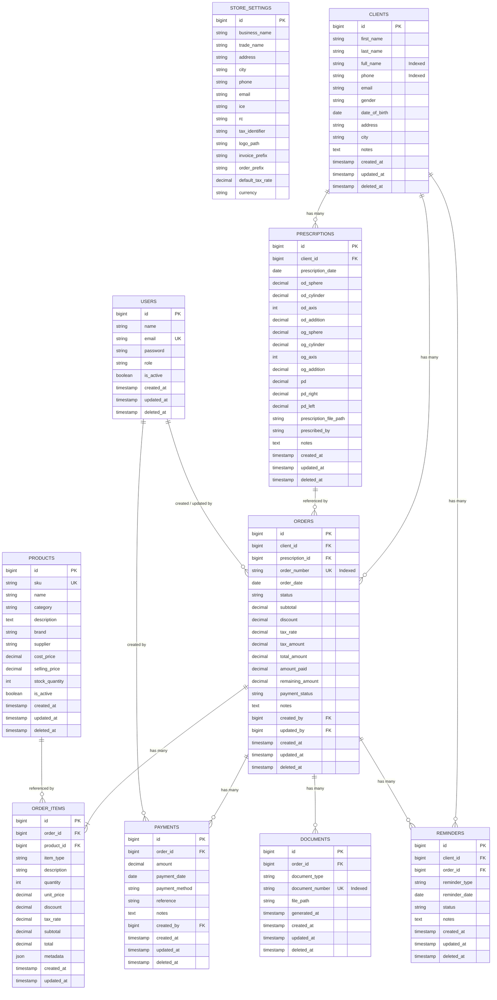

# ALBOPTIC CRM — Architecture & Technical Blueprint

## 1. System Overview
**ALBOPTIC CRM** is an optician-specific business management system designed for **ALBOPTIC** (Marrakech, Morocco). It manages optical clients, clinical eye prescriptions, prescription-based orders, inventory snapshots, partial and full payments, Moroccan tax-compliant document generation (Bon de Commande & Facture), automated customer reminders, and financial KPIs.

---

## 2. Entity-Relationship Diagram (ERD)



---

## 3. Application Directory Structure

```text
app/
├── Enums/
│   ├── DocumentType.php
│   ├── ItemType.php
│   ├── OrderStatus.php
│   ├── PaymentMethod.php
│   ├── PaymentStatus.php
│   ├── ProductCategory.php
│   ├── ReminderStatus.php
│   ├── ReminderType.php
│   └── UserRole.php
├── Models/
│   ├── Client.php
│   ├── Document.php
│   ├── Order.php
│   ├── OrderItem.php
│   ├── Payment.php
│   ├── Prescription.php
│   ├── Product.php
│   ├── Reminder.php
│   ├── StoreSetting.php
│   └── User.php
└── Services/
    ├── DocumentNumberGeneratorService.php
    └── OrderCalculationService.php
database/
├── factories/
├── migrations/
└── seeders/
```

---

## 4. Main Planned Routes & Modules

| Module | Purpose | Main Actions |
|---|---|---|
| **Dashboard** (`/`) | Live KPIs & Counter Activity | Daily sales, payments received, pending debts, today's pickups & reminders |
| **Clients** (`/clients`) | Customer Directory & History | Search by name/phone, create profile, view prescription & order history |
| **Prescriptions** (`/prescriptions`) | Clinical Refraction Data | Record OD/OG, PD, axis, addition, attach scanned Rx, timeline view |
| **Orders** (`/orders`) | Fast Counter Order Wizard | Select client & Rx, add frames & lenses, apply discount, record down payment |
| **Payments** (`/payments`) | Financial Settlements | Record multi-stage payments, view partial balances, filter by method |
| **Documents** (`/documents`) | Tax Invoicing & Receipts | Generate PDF Bon de Commande and Facture with Moroccan ICE/IF/RC |
| **Products** (`/products`) | Basic Optical Inventory | Frames, lenses, sunglasses, accessories, stock thresholds |
| **Reminders** (`/reminders`) | Customer Follow-up Engine | Pickup notifications, payment due reminders, annual vision checkups |
| **Settings** (`/settings`) | Shop Legal & Tax Configuration | ICE, RC, IF, address, default TVA (20%), invoice prefixes |

---

## 5. Development Conventions

1. **Strict Types & Native Enums:** Every PHP class uses `declare(strict_types=1);` and PHP 8.2+ backed enums.
2. **Financial Precision:** Currency fields use `DECIMAL(12,2)`. All financial math is rounded to 2 decimal places using `OrderCalculationService`.
3. **Audit Trail & Soft Deletes:** Core business records use `SoftDeletes` to preserve financial and medical history.
4. **Moroccan Invoicing Compliance:** Store legal identifiers (`ICE`, `RC`, `IF`, `Patente`) are dynamically pulled from `StoreSetting`.
